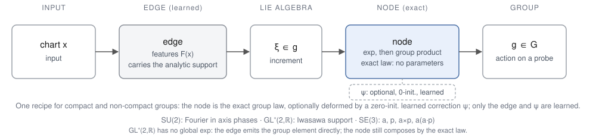
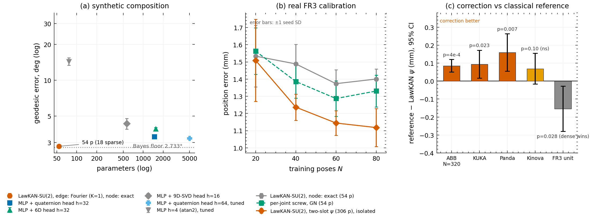

# LawKAN: group-law layers for composition — when imposing a known law pays off

[](LICENSE)
[](https://www.python.org/)

**Keywords:** Kolmogorov–Arnold networks · KAN · group law · transformation composition ·
Lie groups · geometric deep learning · robot-arm calibration · inertial navigation ·
reproducibility · parameter efficiency · tiny models.

## Overview

This repository is the code and reproduction artifact for the LawKAN paper: the
experiments, pinned dumps, mechanical checks, and figure generators behind its tables
and figures.

**Question.** Many tasks compose rotations, poses, or other transformations. The rule for
combining them is known in advance, and it is a non-commutative multiplication. Learned
models must rediscover that rule from data, and small errors compound over many steps.
Classical estimators hard-code the rule, but they cannot represent deviations in real
hardware. These deviations can even change the composition law itself. What if we put the
known rule directly into the model and learn only what remains unknown? The paper asks
where this works, where it gives parity, and where it fails. It studies the question
across three group laws and on real sensors and robots.

**Architecture.** LawKAN is a **group-law layer**. It inherits the KAN edge/node split,
but the node composes by a non-commutative group law rather than adding.

- **Node.** Applies the exact **group law**. A small, zero-initialized, learned correction
  **ψ** modifies it only where the hardware deviates from the law; at ψ=0, the node is exact.
- **Edge.** Learns only the local increment: the coefficients of a map from the input
  chart into the group's increment. The basis functions are fixed in advance, while only
  the coefficients are learned. SU(2) uses Fourier features; GL⁺(2,ℝ) and SE(3) use the
  analytic supports shown in the diagram.
- **Groups.** Tested on compact SU(2), non-compact GL⁺(2,ℝ), and mixed SE(3); only the
  chart, the edge's target, and the node's realization differ.

The wiring is shown above.

**Correction.** The practical gain comes from ψ.

- A classical estimator fixes the law exactly, so it cannot represent a deformation of
  the law itself.
- The edge can already approximate increment-side deviations; ψ targets the remaining,
  law-side ones.
- **Intuition (real arm).** Compliance and play between links make the flange error
  after moving joint A then joint B depend on the load path through both joints. The same
  A gives a different error depending on B, so a fixed per-joint offset cannot remove it.
  The correction has to act on how A and B compose — which is precisely what the law-side
  term ψ targets.
- If the form of the deformation is known, it is imposed too. If it is unknown, ψ learns
  it, trained in isolation with the exact edge frozen.
- Its deviation from zero is a test, not a proof, of the law, and its shape localizes the
  deviation.



*Forward pass: chart → edge → local increment → node → group element. Where the
exponential is global, the edge emits a Lie-algebra increment and the node applies exp;
otherwise (GL⁺) the edge emits the group element directly. The dashed box is the optional
zero-initialized correction ψ. SU(2) uses Fourier edges; GL⁺ and SE(3) use the analytic
support listed in the figure footer.*

**Notation.**

- **N** — number of training poses.
- **Geodesic error** — angle between predicted and true rotations.
- **Bayes floor** — error of the best possible predictor under the input noise.
- **GN** — Gauss–Newton fit of the same classical per-joint-screw model.
- **K** — Fourier order (`K=1` is the minimal exact SU(2) edge).
- **Two-slot** — a ψ correction combining a global and a local term.

Full definitions are in the [glossary](docs/glossary.md).

## Main results

Every number below is reproducible from the pinned dumps in `repro/` (see
[Reproduce the paper numbers](#reproduce-the-paper-numbers)). Six claims, each backed by
a measured result.

- **Tiny models at matched accuracy.** Across tasks the full model has **18–360
  parameters** while matching or beating MLPs tens of times larger.

- **Data efficiency in the scarce regime.** On synthetic composition LawKAN needs **32×
  fewer samples** than the fixed-protocol 6D opponent and **7× fewer** than the strongest
  tuned one; on FR3 at **N=20** it already matches GN (1.51 vs 1.56 mm) and is well below
  the tuned MLP (2.39 mm).

- **A learned law correction can beat fixed classical estimators.** On FR3 it reaches
  **1.12/1.14 mm**, versus **1.29/1.33 mm** for Gauss–Newton and **1.37/1.40 mm** for the
  exact-law baseline; it also wins on ABB, KUKA and Panda (pooled p < 10⁻¹⁰).

- **A diagnostic instrument, not just a model.** It answers two questions:
  - **Span criterion:** can the chosen features represent the law at all? A residual at the
    noise floor means yes; a larger residual is a structural floor, not an optimization
    failure. Demo: `python tools/span_check.py --demo` on a synthetic SU(2) example.
  - **ψ:** is there a law deformation, what kind, and where? ψ starts at the exact law and
    moves only where the data deform it; its shape localizes the deviation. On the measured
    arm task it is **88% orthogonal** to the edge, so it is not merely compensating a weak
    edge.

- **Parity where the classical method carries the same law and the task has no law-side
  deformation.** On consumer IMUs, a gyroscope and three robot arms, the exact node matches
  the classical fits without per-model tuning, with data efficiency at small samples.

- **Boundaries.** It loses when the law is not the task's, when the hidden angle is not
  recoverable from any input, and when the deformation lies outside the correction's span
  or its fit is seed-unstable. A dense classical class wins where it already nests the
  mismatch.



*Three headline checks. (a) Synthetic composition: fixed rotation amounts on SU(2) from
noisy axis observations; the 54-parameter dense edge (18 when sparse) is 27× smaller than
MLP-Quat h=32 and 92× smaller than the tuned h=64, and sits
0.05° above the matched Bayes floor. (b) Real FR3 arm calibration (error bars: ±1 seed SD): at
N=20 the 306-parameter ψ correction ties both references; at N=40/80 it beats both (paired
p≤0.040); at N=60 it beats the exact node (p=0.007) and ties Gauss–Newton (p=0.061). (c)
Paired error difference between the classical same-class reference and the ψ correction,
95% CI; positive = correction better. ABB +0.086 (p=4e-4), KUKA +0.094 (p=0.023), Panda
+0.160 (p=0.007), Kinova +0.070 (p=0.10, ns), FR3 −0.154 (p=0.028, dense screw wins).
References: Gauss–Newton for ABB and the dense per-joint screw for the sockets. Generated by
`tools/figures/fig00_readme_summary.py` from the canonical dumps.*

### The headline experiment: removing the floor on real arm calibration

On the real FR3 arm (114 poses), the exact dense composer and the same-class Gauss–Newton
fit both stall on the deformation floor. Freezing the exact edge and learning only a
306-parameter two-slot ψ correction (global trend + local kernel) removes it:

| N | classical (no ψ) | Gauss–Newton | LawKAN + ψ |
|---:|---:|---:|---:|
| 20 | 1.53 ± 0.18 | 1.56 ± 0.14 | **1.51 ± 0.24** |
| 40 | 1.49 ± 0.11 | 1.39 ± 0.10 | **1.24 ± 0.08** †* |
| 60 | 1.37 ± 0.08 | 1.29 ± 0.10 | **1.14 ± 0.07** * |
| 80 | 1.40 ± 0.06 | 1.33 ± 0.09 | **1.12 ± 0.11** †* |

Held-out position error, mm (mean ± 1 seed SD); * p<0.05 vs the classical no-ψ fit,
† p<0.05 vs Gauss–Newton (paired). The classical no-ψ fit is the same model class as LawKAN
with ψ disabled. Bold: lowest mean. The correction ties both references at N=20, wins at
N=40/80, and at N=60 beats the no-ψ fit but not Gauss–Newton; it also wins on ABB, KUKA and
Panda.

Reproduction commands are in [Reproduce the paper numbers](#reproduce-the-paper-numbers).

## When this helps (and when it does not)

Use LawKAN for the composition **subproblem**, not as a whole-network replacement. The
practical case is a **known law, a law-side deformation, and scarce data**: the exact edge
fixes the law, and ψ learns only the deformation. Where the law holds, expect parity, not a
win.

| Your task | Expected | Use it? |
|---|---|---|
| A same-class classical estimator already exists and the law holds (gyro, strapdown, forward kinematics) | parity: same accuracy with 18–54 parameters and no tuning | only if you need a learned or data-efficient component; otherwise keep the classical estimator |
| Increment is latent but identifiable, and the hardware deviates from the law | win on ABB/KUKA/Panda; ψ trained in isolation | yes — the main case |
| Increment depends on an evolving state (rigid-body ODE) | a feed-forward edge fails | only with a state-conditioned edge (synthetic so far) |
| No group law, or the hidden angle is not recoverable from inputs | loses / information-limited | no |
| Deformation lies outside what ψ can represent, or the fit is seed-unstable | floor or instability | no; keep the classical form |

Before training, run the [span check](#check-your-own-task-the-span-criterion): it tells you
whether the chosen edge can represent the law at all.

## Who this is for

- **Robot and sensor engineers:** a small component for composition subproblems. Use the exact
  node when the law holds (parity); add ψ when the hardware deviates from the law (ABB/KUKA/Panda).
  Not for generic regression or hidden-angle tasks.
- **KAN and geometric deep learning researchers:** an exact group-law node with fixed edge
  bases, a pre-training span check, and measured win/parity/loss on SU(2), GL⁺(2,ℝ) and SE(3).
- **Reviewers and reproducers:** 120 canonical blocks, 171 number checks, a CPU reference
  runner, the span demo, and per-block logs.
- **Not for:** generic regression, tasks without a group law, or angles that cannot be
  recovered from the inputs.

## Installation

Clone this repository, then from its root:

```bash
pip install -r requirements.txt   # torch (CUDA build recommended), numpy, scipy, pandas,
                                  # h5py, matplotlib, scienceplots, vqf,
                                  # roboticstoolbox-python, robotkinecal, rtb-data==1.1.0
```

Python 3.8+ (all scripts smoke-tested on 3.8.10). CPU works but is slow. The MIT
FR3/IPA/pauljac subsets are included under `data/`; BROAD and MUKCa are cloned separately,
and ABB RobotCali is manual (no redistribution license; verify it with
`python tools/check_abb_data.py`) — the data table and the paper-item → command map
are in [`REPRODUCE.md`](REPRODUCE.md).

## Minimal example — the node

```python
import torch

def exp_so3(v):                                  # rotation vector -> unit quaternion
    th = v.norm(dim=-1, keepdim=True).clamp_min(1e-12)
    return torch.cat([torch.cos(th / 2), (v / th) * torch.sin(th / 2)], dim=-1)

def q_mul(a, b):                                 # Hamilton product: the exact node
    aw, ax, ay, az = a.unbind(-1); bw, bx, by, bz = b.unbind(-1)
    return torch.stack([aw*bw - ax*bx - ay*by - az*bz,
                        aw*bx + ax*bw + ay*bz - az*by,
                        aw*by - ax*bz + ay*bw + az*bx,
                        aw*bz + ax*by - ay*bx + az*bw], dim=-1)

edge = torch.nn.Sequential(torch.nn.Linear(4, 3))   # the learned part (by default the only one)
x1 = torch.randn(8, 4); x2 = torch.randn(8, 4)       # placeholder input features
R = q_mul(exp_so3(edge(x2)), exp_so3(edge(x1)))     # the node composes; nothing here is learned
```

The snippet shows the compact SU(2) instance; GL⁺(2,ℝ) and SE(3) change only the chart,
the edge target and the node's realization. The full-scale versions (Fourier edges, the
relaxed `ψ` node, the per-joint SE(3) arm model) are in [`experiments/`](experiments/).

## Check your own task: the span criterion

Before training, a cheap linear probe tells you whether the chosen edge can represent your task at all.
Write the target's chart logarithm, fit the edge features to it, and compare the held-out residual with
the noise floor: a residual at the floor means the features span the composition (the exact node is
representable); a larger residual is a training-independent floor that no width or schedule will close.

```bash
python tools/span_check.py --demo        # synthetic SU(2) increment, three cases
python tools/span_check.py --data X.npy --target Y.npy   # your features and chart-logarithm targets
```

The demo prints three rows: the Fourier edge on the true axes (gap 0), on noisy axes (gap at the noise
floor, so the span is full), and with the α features removed (gap ≈ 0.58, a floor). The criterion is
Proposition 1 in the paper; the practical checklist is its §5.7.

## Reproduce the paper numbers

```bash
python repro/run_registry.py --tier headline --dry-run  # registry-driven command preview
python repro/run_registry.py --tier headline --mode reference  # CPU reference, ~overnight
bash repro/run_all.sh headline-smoke  # minutes-scale sanity of the quick-capable blocks
python repro/check_canonical.py       # every canonical dump exists and is tracked (120 blocks)
python repro/check_numbers.py         # 171 displayed numbers vs the canonical dumps
python repro/stats/check_derived.py   # Table 3 CI, branch T1/T2, multiple-testing correction (18 checks)
python repro/check_cpu_reference.py   # portable CPU-run verification
python repro/make_tables.py           # mechanical JSON -> markdown tables for every block
```

### Headline and cross-vendor

```bash
# the paper's Figure 3a curves (exact/GN, isolated two-slot, tuned MLP; 5 seeds, N=20/40/60/80)
python repro/run_registry.py --only x7bench,x35,x22 --mode reference

# the registered 10-seed replication at N = 60/80
python experiments/real/G2bc_isolated_psi.py --part fr3 --fr3-split random --fr3-psi fourier --sizes_fr3 60,80 --seeds_fr3 10

# its controls: exact-law data (no held-out gain) and deformed-law data (recovery)
python experiments/real/G2bc_isolated_psi.py --part s1

# regenerate the summary chart shown above
python tools/figures/fig00_readme_summary.py

# cross-vendor replication (panel (c) and the pooled verdict)
bash repro/run_all.sh stage9   # MUKCa socket family
bash repro/run_all.sh stage10  # ABB RobotCali
python repro/check_numbers.py  # every number in this section vs the canonical dumps
```

The harness defaults to the **CPU reference** path (`--mode reference`); `--mode gpu` is optional.
Synthetic blocks run on CPU float32, applied/revision blocks on CPU float64; `repro/registry.json`
records the reference device/dtype per block; the runner enforces the device (CPU reference by
default) and records the dtype used by each canonical block.

`headline` runs the blocks behind the main tables (1-5) and Figures 2-4; `stage15` runs the
pole-fix branch (X37-X61) and `full` covers every block. Appendix blocks are `stage9` (MUKCa
socket family), `stage10` (ABB RobotCali), `stage11` (TinyGC/VQF/X16), `stage12` (diagnostics
G2a/G2bc/G3/G4, X17, S8) and `stage13` (validity package X18-X21, POOL). Per-experiment
details and the direct-run commands are in [`docs/blocks.md`](docs/blocks.md).

**Preprint:** link will be added upon posting.
**Reference hardware:** the portable reference is CPU (synthetic float32, applied/revision
float64); the original synthetic dumps were also produced on an NVIDIA RTX 2080 SUPER, and the
CPU path is verified against them (`repro/check_cpu_reference.py`, including the X38 socket block).

## Repository layout

```
lawkan/
├── experiments/synthetic/   # core battery: run_main, run_extensions, E16-E40
├── experiments/real/        # real-data probes, validity and revision/branch: X5-X61, S*, G*, MK1*, RC1, POOL
├── repro/                   # registry-driven harness, canonical.json (120 blocks), checks, provenance
├── tools/figures/           # vector figures generated from the dumps
├── tools/span_check.py      # the span-criterion probe (see 'Check your own task')
├── assets/                  # diagrams and README figures
├── docs/                    # blocks.md, results.md, predictions.md, faq.md, glossary.md, paper.md
├── llms.txt, llms-full.txt  # machine-readable digests for language models
├── REPRODUCE.md             # data prerequisites and the paper-item -> command map
├── THIRD_PARTY.md           # third-party data and libraries
├── codemeta.json, .zenodo.json
└── CITATION.cff
```

Every headline and branch number is backed by the pinned dumps; derived counts and
statistics are checked separately by the derived/CPU gates. `repro/registry.json` is the
machine-readable block → script → tier → paper-item map, and the full script-to-paper
overview is in [`docs/blocks.md`](docs/blocks.md).

## Documentation

- [`docs/paper.md`](docs/paper.md) — the paper title and a condensed repository abstract.
- [`docs/results.md`](docs/results.md) — headline results, each checked mechanically against the dumps.
- [`docs/predictions.md`](docs/predictions.md) — the **full predictions log**: every experiment pre-specified a prediction in the authors’ internal experiment log before its run, refuted predictions are kept, and each row is a prediction → outcome → verdict. This is the paper's reporting protocol, counted in its appendix.
- [`docs/blocks.md`](docs/blocks.md) — the per-block script-to-paper map and direct-run commands.
- [`docs/faq.md`](docs/faq.md), [`docs/glossary.md`](docs/glossary.md) — background and terminology.
- [`REPRODUCE.md`](REPRODUCE.md) — data prerequisites and the paper-item → command map.
- [`THIRD_PARTY.md`](THIRD_PARTY.md) — third-party data and libraries.

## FAQ

Short answers; the **full FAQ** is [`docs/faq.md`](docs/faq.md).

- **Is LawKAN a quaternion network?** No. A quaternion or 6D output head is a
  parameterization choice; LawKAN fixes the composition law in the node and learns only
  the local increment.
- **Why do some class names and JSON dump keys say `QuatKAN`?** That is the internal
  historical spelling kept for provenance; the family is called LawKAN.
- **My rerun disagrees with the dumps.** Open a
  [reproduction issue](.github/ISSUE_TEMPLATE/reproduction-mismatch.md) with your `run.log`
  and the dump you compare against. The data/command map and CPU/GPU policy are in
  [`REPRODUCE.md`](REPRODUCE.md).

## Reporting policy

The project registers every prediction before its run (the paper's counting summary is its
appendix; the full log is [`docs/predictions.md`](docs/predictions.md)). The current total is
130 verdicts: 59 in the main battery, 30 in the later validity/physics package, 30 in the
revision round on the capacity and locality of the law correction (X22–X36), and 11 in the
pole-fix branch (X37–X61). Two mechanism hypotheses were refuted and reported; the branch
adds the chart-singularity, EMA, group-metric and T1/T2 probes. Several entries are rejected or only
partially supported, including cases where the measured effect missed the registered
threshold by a small margin, and one initially refuted prediction (P13) was confirmed only after a
flaw in our own probe code was found and fixed. Those negative and borderline results are
part of the paper, and these scripts reproduce them too.

## Data and licenses

The code is AGPL-3.0-or-later. Third-party datasets retain their own licenses:

- **BROAD** — CC BY 4.0, `dlaidig/broad`.
- **MUKCa** — MIT, `platonics-delft/kinematics_calibration`.
- **FR3 / PhilNad** — MIT, `PhilNad/robot-arm-kinematic-calibration`; see `data/FR3_LICENSE`.
- **IPA Series A / UR10** — MIT, `christianlandgraf/ipa-robot-accuracy`.
- **pauljac UR5** — MIT, 1020 poses, `pauljac7700/serial_robots_datasets`.
- **GTPN UR5** — CC BY 4.0, Zenodo `10.5281/zenodo.18954650`, not vendored.
- **Baxter** — CC BY 4.0, Zenodo `10.5281/zenodo.17035193`, not vendored.
- **ABB RobotCali** — no explicit license; used under the authors' permission for calibration/verification, not redistributed.

See [`THIRD_PARTY.md`](THIRD_PARTY.md) for details.

## License

AGPL-3.0-or-later applies to the original code and documentation in this repository, not to
third-party data. Third-party datasets retain their original licenses (MIT or CC BY 4.0), listed
in [`THIRD_PARTY.md`](THIRD_PARTY.md) and in the per-dataset `LICENSE` files; ABB RobotCali is not
redistributed. Commercial licensing of the original code is available on request.

## Citation

See [`CITATION.cff`](CITATION.cff); the paper reference and BibTeX will be added when the
preprint is posted.
